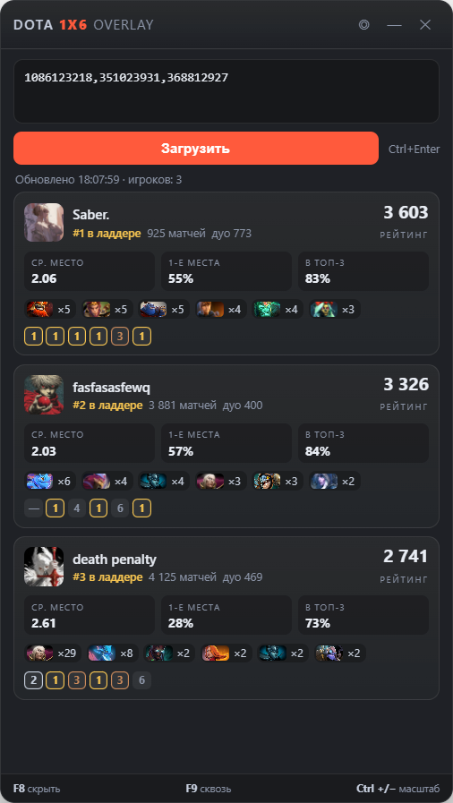

# Dota 1x6 Overlay

Оверлей поверх Dota 2 со статистикой игроков [Dota 1x6](https://dota1x6.com).
Данные берутся из публичного API сайта, игру и кастомку модифицировать не нужно.



## Скачать

Собирать проект вручную не нужно — готовые сборки лежат в
[**Releases**](https://github.com/dig-png/dota1x6-overlay/releases):

- **`Dota1x6Overlay-Setup-<версия>.exe`** — установщик: ярлык в «Пуске» и на рабочем столе;
- **`Dota1x6Overlay-Portable-<версия>.exe`** — портативный вариант, просто запустить без установки.

Сборка не подписана, поэтому при первом запуске Windows SmartScreen может показать
предупреждение: «Подробнее» → «Выполнить всё равно».

## Возможности

- рейтинг и место в ладдере (топ-50), матчи, среднее место, % первых мест и топ-3, дуо-рейтинг;
- пул героев по последним 50 матчам (игры, ср. место, винрейт в тултипе);
- последние 6 игр;
- клик по карточке открывает профиль на сайте;
- прозрачное окно always-on-top, режим «клик-сквозь», масштаб интерфейса.

## Требования

- Windows 10/11;
- Dota 2 в режиме **«Оконный без рамки»** — поверх эксклюзивного полного экрана оверлей не рисуется.

Для запуска из исходников дополнительно нужен Node.js 20+.

## Запуск из исходников

```powershell
npm install
npm start
```

Либо двойной клик по `start-overlay.vbs` (без окна консоли).

## Сборка релиза

```powershell
npm run dist            # установщик + портативный exe в dist/
npm run dist:portable   # только портативный exe
```

Релиз публикуется автоматически: поставь тег и запушь —

```powershell
git tag v1.0.0
git push origin v1.0.0
```

GitHub Actions соберёт `Dota1x6Overlay-Setup-<версия>.exe` и
`Dota1x6Overlay-Portable-<версия>.exe` и приложит их к релизу.

## Использование

Вставь в поле SteamID64, `account_id` или ссылку на профиль Steam (по одному в строке
или через запятую) и нажми **Загрузить** / `Ctrl+Enter`. Поддерживаются `STEAM_0:x:y` и `[U:1:x]`.

## Горячие клавиши

| Клавиша | Действие |
|---|---|
| `F8` | скрыть / показать оверлей |
| `F9` | клик-сквозь вкл/выкл |
| `Ctrl +` / `Ctrl -` | масштаб интерфейса (по умолчанию 115%) |
| `Ctrl 0` | сбросить масштаб |
| `Ctrl+Enter` | загрузить статистику |
| `Ctrl+Shift+X` | закрыть |

## Данные

Публичный API без ключей и авторизации:

```
https://stats.dota1x6.com/api/v2/players?playerId=<account_id>
https://stats.dota1x6.com/api/v2/players/steam-profile?playerId=<account_id>
https://stats.dota1x6.com/api/v2/matches/history?playerId=<account_id>&page=1&count=25
https://stats.dota1x6.com/api/v2/leaderboard
```

`account_id` — 32-битный ID Steam, а не SteamID64; оверлей конвертирует автоматически.

## Ограничения

- Состав лобби вводится вручную: Dota 2 не отдаёт список игроков лобби сторонним приложениям.
- Ладдер в API — только топ-50.
- Пул героев считается по последним 50 матчам.
- Показываются только игроки, зарегистрированные на dota1x6.com.
- Кэша нет: каждое нажатие «Загрузить» делает свежие запросы.
